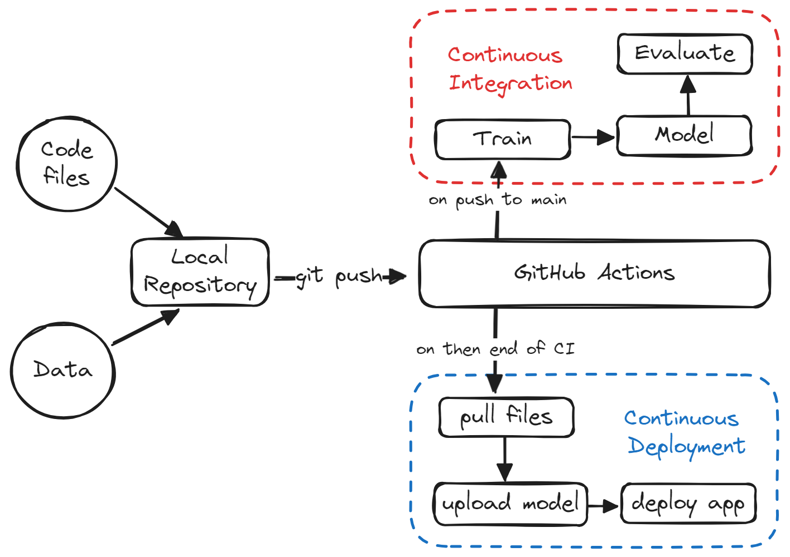
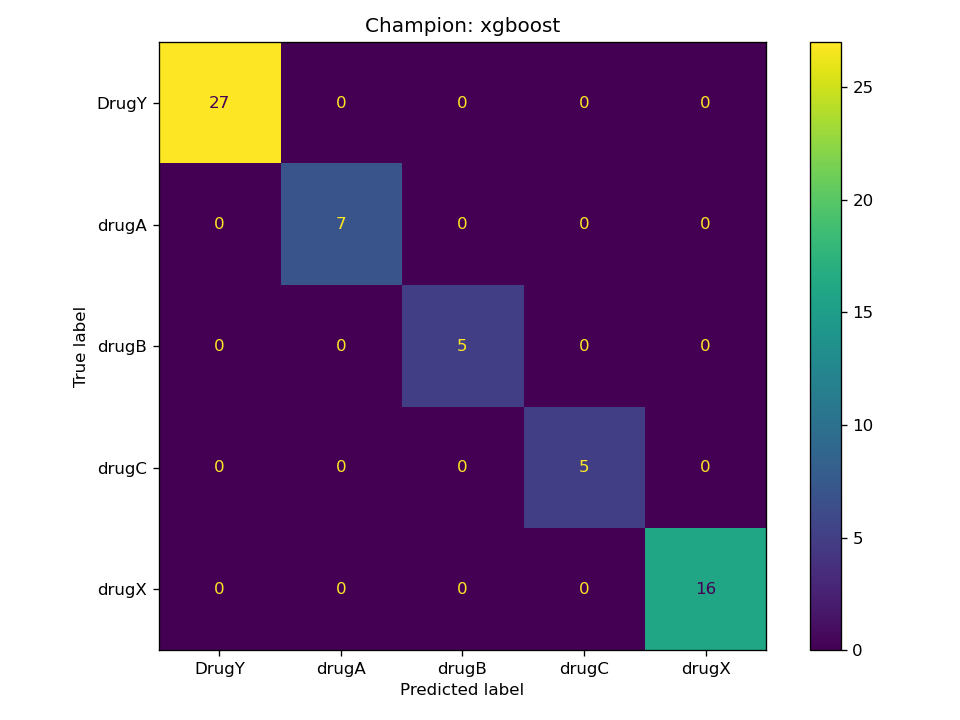

# Drug Classifier MLOps

[](https://github.com/Vansh1412/Drug-Classifier-MLOPS/actions/workflows/ci.yml)
[](https://github.com/Vansh1412/Drug-Classifier-MLOPS/actions/workflows/cd.yml)
[](https://colab.research.google.com/github/Vansh1412/Drug-Classifier-MLOPS/blob/main/notebook.ipynb)

An end-to-end MLOps project demonstrating automated model training, testing, containerization, and deployment using GitHub Actions CI/CD.

## Project Description

This project builds a **Drug Classification** model using a `scikit-learn` Random Forest pipeline trained on patient data (age, sex, blood pressure, cholesterol, Na-to-K ratio). The full lifecycle — from training to deployment — is automated via GitHub Actions.

**Key Features:**
- 🤖 **ML Pipeline** — Scikit-learn `RandomForestClassifier` with preprocessing pipeline
- 🌐 **REST API** — FastAPI server with `POST /predict` and `GET /health` endpoints
- 🐳 **Docker** — Multi-stage Dockerfile with health checks for containerized deployment
- ✅ **Automated Testing** — 6 pytest unit tests covering model and API
- ⚙️ **CI/CD** — GitHub Actions pipeline: train → test → docker build → evaluate → deploy
- 🐧 **Linux Deploy Script** — `deploy.sh` for zero-downtime container replacement

## Tech Stack

| Category | Tools |
|---|---|
| Language | Python |
| ML | Scikit-learn, Pandas, NumPy, Skops |
| API | FastAPI, Uvicorn, Pydantic |
| Testing | pytest, httpx |
| Containerization | Docker, Docker Compose |
| CI/CD | GitHub Actions, CML (Iterative) |
| Deployment | Hugging Face Spaces, Linux |

## API Usage

```bash
# Health check
curl http://localhost:8000/health

# Predict drug
curl -X POST http://localhost:8000/predict \
  -H "Content-Type: application/json" \
  -d '{"age": 30, "sex": "M", "blood_pressure": "HIGH", "cholesterol": "NORMAL", "na_to_k_ratio": 15.4}'
```

## Run Locally

```bash
# Install dependencies
make install

# Train model
make train

# Run tests
make test

# Start FastAPI server
make run-api

# Build & run Docker container
make docker-build
docker compose up
```

## Pipeline



## Results

| Model | Accuracy | F1 Score |
|---|---|---|
| RandomForestClassifier | 97.0% | 94.0% |


